

  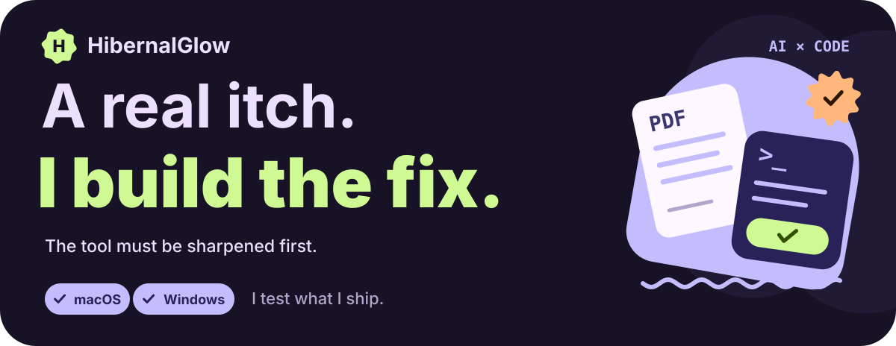

  <a href="README.md"><b>中文</b></a> · <b>English</b> · <a href="https://hibernalglow.github.io/">website</a>

  
  
  
  
  
  
  

I write tools for my own use: pipelines for documents and study material, output validators for AI agents, and cross-platform desktop apps. I use a Mac and a Windows machine every day, so cross-platform is a hard requirement; I prefer modular, plugin-based designs, so anything that can be split off stays split; and I have my own taste in interfaces, which keeps pulling me toward MD3 Expressive.

Many of these started the same way: a tool hurt during ordinary use, I took it to the author, and either they refused outright or had no time to fix it — so I made it myself.

What actually holds my attention is the layer under the interface: archive format parsing, text encoding detection, thumbnail cache pipelines, shell invocation and process supervision. Whether a tool is any good comes down to whether it runs steadily on your real local files.

<!-- Each project is a separate SVG; only this HTML arranges the cards. -->

  <a href="https://github.com/HibernalGlow/MineruCustom">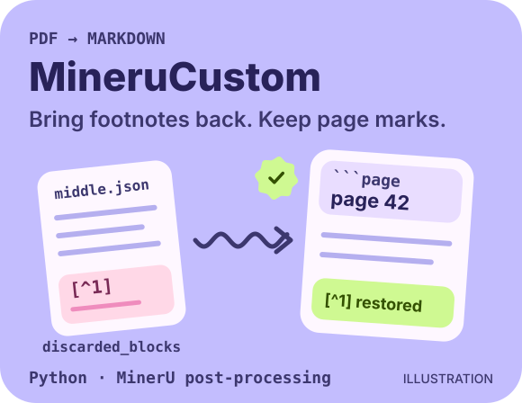</a>
  <a href="https://github.com/HibernalGlow/skilloom">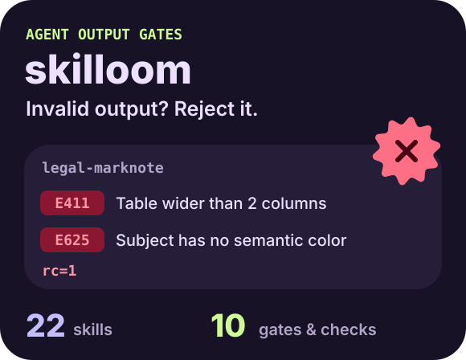</a>

  <a href="https://github.com/HibernalGlow/neoview">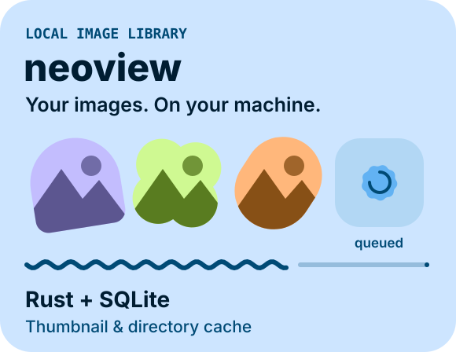</a>
  <a href="https://github.com/HibernalGlow/grzeb">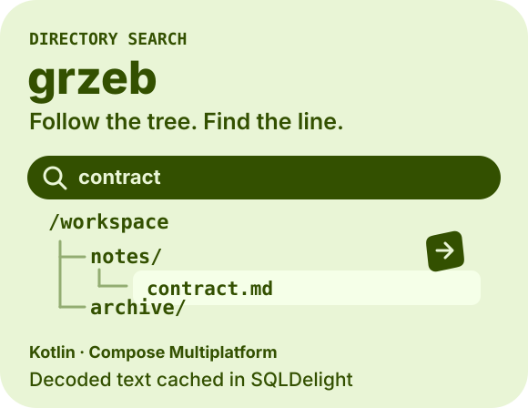</a>

  <a href="https://github.com/HibernalGlow/Xaihi">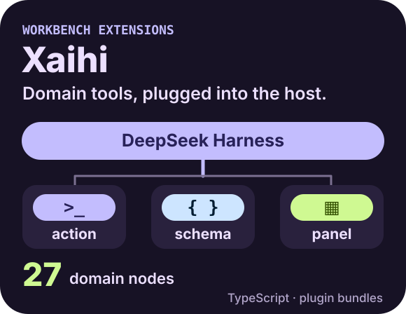</a>
  <a href="https://github.com/HibernalGlow/siyuan-damophus">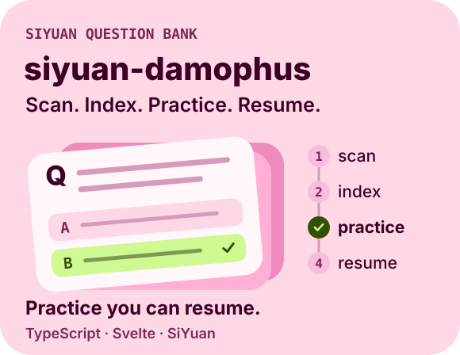</a>

  <a href="https://github.com/HibernalGlow/rossi">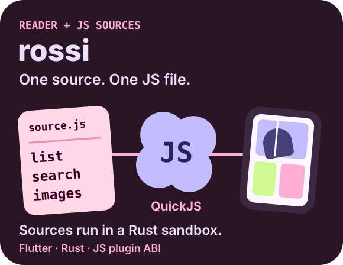</a>
  <a href="https://github.com/HibernalGlow/ArcThumbX">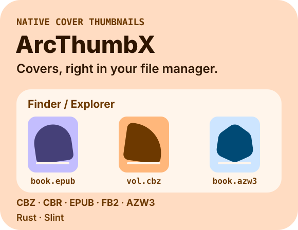</a>

  <a href="https://github.com/HibernalGlow/Xlchemy">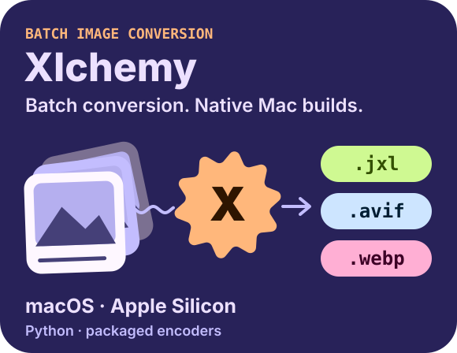</a>
  <a href="https://github.com/HibernalGlow/czkawka-tauri">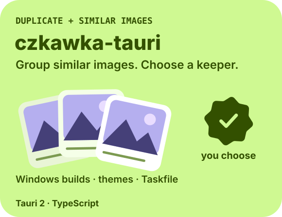</a>

  <a href="https://github.com/HibernalGlow/hibernal">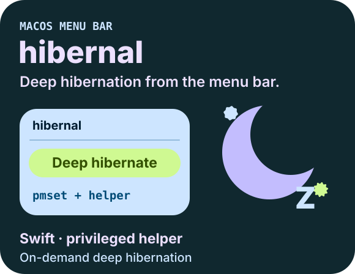</a>
  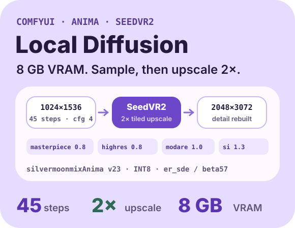

| Project | Stack | What it is |
| --- | --- | --- |
| [MineruCustom](https://github.com/HibernalGlow/MineruCustom) | Python · MinerU | Post-processing tool from PDF to Markdown: recovers dropped paragraphs, restores footnotes and injects page anchors. 8 stars (including one from MinerU maintainer [myhloli](https://github.com/myhloli)) |
| [skilloom](https://github.com/HibernalGlow/skilloom) | Python | 22 agent skill packs + 10 automatic validation scripts that block output with the wrong format or structure before it is ever written to disk |
| [neoview](https://github.com/HibernalGlow/neoview) | Tauri 2 · Svelte 5 · Rust · PyO3 | Local-first image and manga reader that manages the thumbnail and directory cache with Rust + SQLite; 2,828 commits in total |
| [grzeb](https://github.com/HibernalGlow/grzeb) | Kotlin · Compose Multiplatform · SQLDelight | Directory-level full-text search where results expand down the directory tree instead of a flat list; its README states plainly which features are not implemented yet |
| [Xaihi](https://github.com/HibernalGlow/Xaihi) | TypeScript · DeepSeek Harness | Workbench extension layer: 27 domain nodes, each with its own backend actions, parameter table and panel, all attached to the original project through its standard plugin interface, with no need to modify the host directly or fork it |
| [siyuan-damophus](https://github.com/HibernalGlow/siyuan-damophus) | TypeScript · Svelte | SiYuan question-bank plugin covering scan, index, practice and progress recovery; 710 commits on my branch (upstream has 512) |
| [rossi](https://github.com/HibernalGlow/rossi) | Flutter · Rust · JS plugin ABI | Shell-only reader: it ships no content itself, each source is a separate JS script defining how to fetch lists, search and load images, executed in a QuickJS sandbox on the Rust side · 2 stars |
| [ArcThumbX](https://github.com/HibernalGlow/ArcThumbX) | Rust · Slint | Shows CBZ / CBR / EPUB / FB2 / AZW3 cover thumbnails directly in Windows Explorer and macOS Finder · 2 stars |
| [Xlchemy](https://github.com/HibernalGlow/Xlchemy) | Python · release builds | Batch JPEG XL / AVIF / WebP conversion tool. Built on `xl-converter`, 11 releases so far: added the macOS Apple Silicon native package upstream was missing, and removed the installer's dependency on the build machine's Homebrew |
| [czkawka-tauri](https://github.com/HibernalGlow/czkawka-tauri) | Tauri 2 · TypeScript | Desktop front end for the duplicate / similar-image cleanup tool. Built on upstream, 9 releases, ships a separately packaged Windows build, plus custom themes and a Taskfile task set |
| [hibernal](https://github.com/HibernalGlow/hibernal) | Swift | macOS menu-bar tool for on-demand deep hibernation (`pmset` + privileged helper). Upstream stopped at `v1.4.5`; I took it to 2.0.0 and packaged an installable DMG |
| [ComfyUI-Workflow-Studio](https://github.com/HibernalGlow/ComfyUI-Workflow-Studio) | Python | ComfyUI running on a Windows host, scheduled remotely over SSH with ComfyUI-Workflow-Studio: `silvermoonmixAnima v23 INT8` base, style and character LoRAs stacked in order, 45 full-diffusion steps to 1024×1536, then SeedVR2 3B fp8 tiled upscaling to 2048×3072.   |

Below are original projects alongside work derived from open-source ones (forks). Every fork repository keeps the original author and license information in its own README and states what I changed on top of upstream.

**Documents and study material**
[MineruCustom](https://github.com/HibernalGlow/MineruCustom) · [MarkdownWrapper](https://github.com/HibernalGlow/MarkdownWrapper) · [siyuan-damophus](https://github.com/HibernalGlow/siyuan-damophus) · [InkLoom](https://github.com/HibernalGlow/InkLoom) (legal-notes site with Remotion explainers embedded in the page; no longer updated)

**Agent and ComfyUI workflows**
[skilloom](https://github.com/HibernalGlow/skilloom) · [ComfyUI-Workflow-Studio](https://github.com/HibernalGlow/ComfyUI-Workflow-Studio) · [ComfyUI-GlowLoader](https://github.com/HibernalGlow/ComfyUI-GlowLoader) · [lazypi](https://github.com/HibernalGlow/lazypi) · [omp-decktop](https://github.com/HibernalGlow/omp-decktop) · [auto-continue](https://github.com/HibernalGlow/auto-continue)

**Readers, archive formats and the tools underneath**
[rossi](https://github.com/HibernalGlow/rossi) · [neoview](https://github.com/HibernalGlow/neoview) · [quivi-t](https://github.com/HibernalGlow/quivi-t) · [neoxide](https://github.com/HibernalGlow/neoxide) · [opencomic-ai-bin](https://github.com/HibernalGlow/opencomic-ai-bin)

**Image and document pipelines**
[Xlchemy](https://github.com/HibernalGlow/Xlchemy) (batch JPEG XL / AVIF / WebP) · [Trimg](https://github.com/HibernalGlow/Trimg) · [czkawka-tauri](https://github.com/HibernalGlow/czkawka-tauri) (dedup) · [FolioX](https://github.com/HibernalGlow/FolioX) (local batch OCR) · [manga-translator-ui](https://github.com/HibernalGlow/manga-translator-ui)

**Search and local data**
[grzeb](https://github.com/HibernalGlow/grzeb) (Kotlin · Compose Multiplatform: full-directory search that expands down the directory tree, with decoded text cached in SQLDelight)

**Developer tooling and automation**
[aestivus](https://github.com/HibernalGlow/aestivus) (Tauri + SvelteKit + FastAPI: turns a chain of Python scripts into visual drag-and-drop orchestration, calling the local system Python directly) · [TaskGui](https://github.com/HibernalGlow/TaskGui) (parses `Taskfile.yml`, shows tasks as cards, runs them serially or in parallel) · [PresetUI](https://github.com/HibernalGlow/PresetUI) (terminal preset picker prototype on rich / textual) · [trename](https://github.com/HibernalGlow/trename) (GPU-accelerated AI image tagging CLI on WD14 / MD-Danbooru)

**OS integration**
[hibernal](https://github.com/HibernalGlow/hibernal) (`pmset` deep hibernation, with a privileged helper) · [Shiin](https://github.com/HibernalGlow/Shiin) (gamepad-combo screenshots and OBS instant replay, Windows / macOS) · [ArcThumbX](https://github.com/HibernalGlow/ArcThumbX) · [AppuruPie](https://github.com/HibernalGlow/AppuruPie) (mouse-wheel gesture layer) · [SmartZ](https://github.com/HibernalGlow/SmartZ)

<!--

I study law, and my internship at a law firm left me with some very concrete pain points. Most of what clients hand over arrives as phone photos and WeChat chat screenshots. Revising a document usually means changing one line, saving yet another file, and passing it back and forth. A search for statutes or case law that cannot produce a real case number is read as AI-made at first glance.

Those experiences decided how I build document tooling. Loose material first becomes Markdown carrying page anchors, so every conclusion can be followed back along the page number to the original. Then a validation script screens the AI output, and anything with a broken format or a missing source is stopped there. The model only drafts and tidies; the case numbers, sources and conclusions still go through a person.
-->

- **Both original projects and maintained forks.** The ones built on upstream — `siyuan-damophus`, `Extras-Glow`, `rossi`, `Xlchemy`, `czkawka-tauri`, `hibernal`, `ComfyUI-Workflow-Studio`, `ArcThumbX` — keep following upstream rather than freezing at some historical snapshot. When syncing an upstream fix I work out the preconditions behind the change, not just the code, so that merging does not break what either side already did. The original ones — `MineruCustom`, `skilloom`, `neoview`, `grzeb`, `Xaihi` — were built from nothing, with the interface design and acceptance criteria set by me.
- **Verifiable results before automation.** An AI generation tool has to ship with automatic validation first, able to check that the format is compliant and the content traceable to a source. If it cannot do that, automation is only manufacturing errors faster.
- **Chinese compatibility as a hard requirement.** Plenty of tools claim to work and then garble text or fail to find anything the moment Chinese is involved, so the encoding detection order is fixed in code: check BOM and binary NUL bytes first, then try UTF-8, decode as GB18030 only after two pre-checks pass, and fall back to Latin-1 last. Whole-word regex matching is switched off explicitly for CJK, because `\b` cannot form a boundary around Chinese words.
- **Documentation states the limits before the features.** When writing a README I list outright which features are not done and why, and which behaviour already exists in the core but still has no switch in the interface, so users don't have to step into the hole themselves.
- **Local-first by default.** Files stay on the local disk, indexes stay in a local database, and model inference runs on the machine wherever possible.
