

  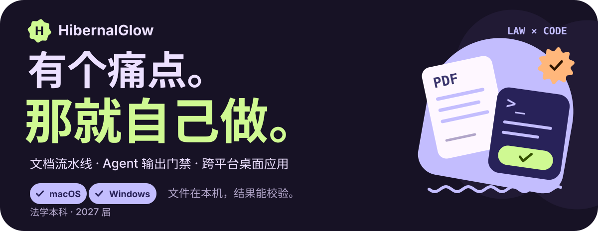

  <b>中文</b> · <a href="README.en.md">English</a>

  
  
  
  
  
  
  

我平时写一些自己用的工具：文档和学习资料的处理流水线、给 AI Agent 用的输出校验脚本，以及跨平台桌面应用。因为日常同时用 Mac 和 Windows，所以跨平台是硬性要求；偏爱模块化和插件化设计，能拆开的绝不塞在一起；对界面也有自己的偏好，一直在往 MD3 Expressive 的风格靠。

很多项目的起因都一样：平时用工具遇到了痛点，去给作者提意见，要么被明确拒绝，要么对方没空改——那就干脆自己动手做。

相比表面的界面，真正让我着迷的是底下那一层：压缩包格式解析、文本编码识别、缩略图缓存管线、Shell 调用和进程守护。一个工具好不好用，全看放到你真实的本地文件上能不能稳稳跑通。

<!-- Each project is a separate SVG; only this HTML arranges the cards. -->

  <a href="https://github.com/HibernalGlow/MineruCustom">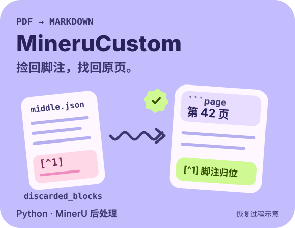</a>
  <a href="https://github.com/HibernalGlow/skilloom">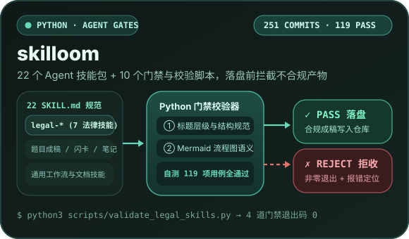</a>

  <a href="https://github.com/HibernalGlow/neoview">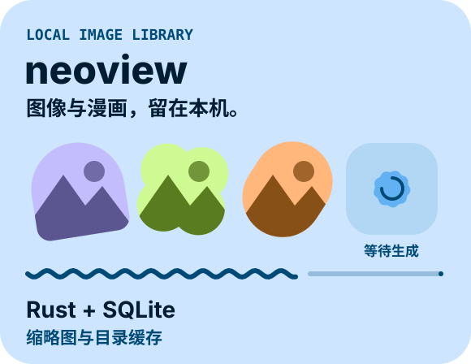</a>
  <a href="https://github.com/HibernalGlow/grzeb">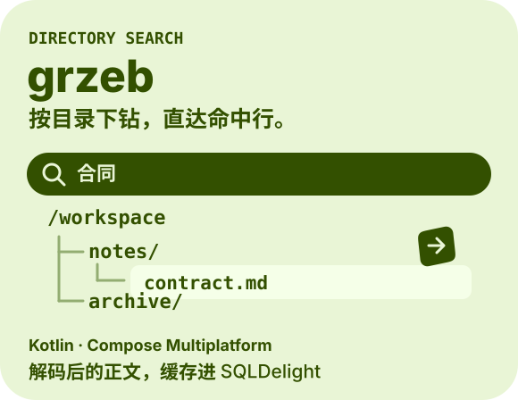</a>

  <a href="https://github.com/HibernalGlow/Xaihi">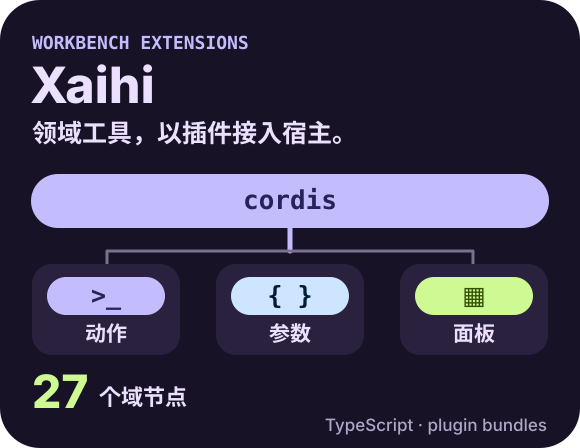</a>
  

  <a href="https://github.com/HibernalGlow/rossi">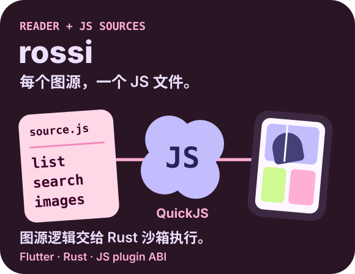</a>
  <a href="https://github.com/HibernalGlow/ArcThumbX">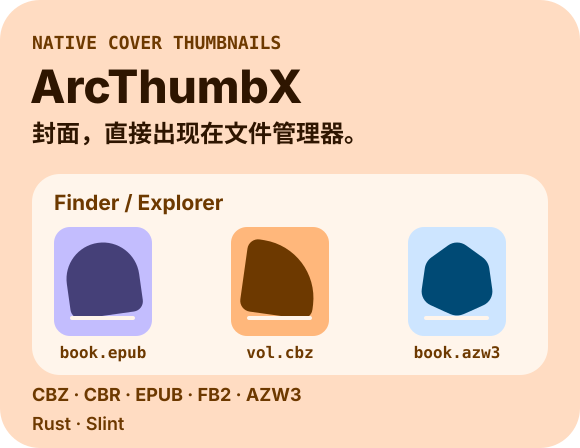</a>

  <a href="https://github.com/HibernalGlow/Xlchemy">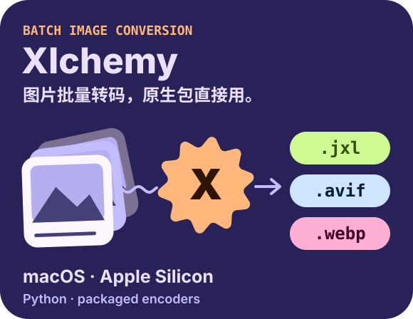</a>
  <a href="https://github.com/HibernalGlow/czkawka-tauri">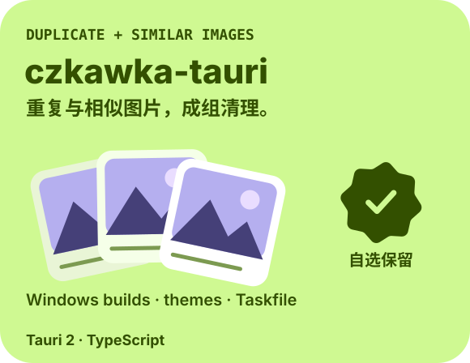</a>

  <a href="https://github.com/HibernalGlow/hibernal">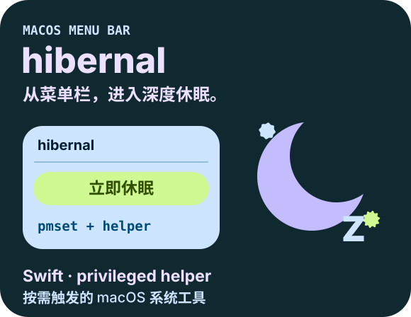</a>

  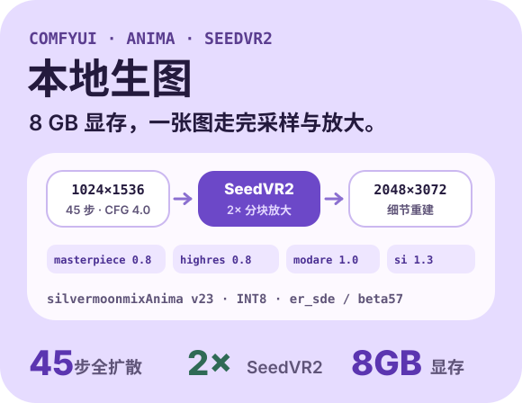

| 项目 | 技术栈 | 是什么 |
| --- | --- | --- |
| [MineruCustom](https://github.com/HibernalGlow/MineruCustom) | Python · MinerU | PDF 转 Markdown 后处理工具：找回丢失段落、恢复脚注并注入页码锚点。获 8 Star（含 MinerU 维护者 [myhloli](https://github.com/myhloli)） |
| [skilloom](https://github.com/HibernalGlow/skilloom) | Python | 22 个 Agent 技能包 + 10 个自动校验脚本，在落盘前直接拦截格式或结构不合格的生成结果 |
| [neoview](https://github.com/HibernalGlow/neoview) | Tauri 2 · Svelte 5 · Rust · PyO3 | 本地优先的图像与漫画阅读器，用 Rust + SQLite 管理缩略图与目录缓存；累计 2,828 次提交 |
| [grzeb](https://github.com/HibernalGlow/grzeb) | Kotlin · Compose Multiplatform · SQLDelight | 目录级全文检索工具，搜索结果按目录树逐层展开而非平铺罗列；README 中明确列出了尚未实现的功能 |
| [Xaihi](https://github.com/HibernalGlow/Xaihi) | TypeScript · DeepSeek Harness | 工作台扩展层：27 个领域节点各自带后端动作、参数表与面板，全部通过标准插件接口接入原项目，无需直接修改或 fork 宿主代码 |
| [siyuan-damophus](https://github.com/HibernalGlow/siyuan-damophus) | TypeScript · Svelte | 思源笔记题库插件：覆盖扫描、索引、刷题与进度恢复；本地分支已演进 710 次提交（上游为 512 次） |
| [rossi](https://github.com/HibernalGlow/rossi) | Flutter · Rust · JS plugin ABI | 纯壳阅读器：本身不内置内容，每个图源都是独立的 JS 脚本，用来定义如何拉取列表、搜索和加载图片，由 Rust 端 QuickJS 沙箱执行 · 2 Star |
| [ArcThumbX](https://github.com/HibernalGlow/ArcThumbX) | Rust · Slint | 在 Windows 资源管理器和 macOS Finder 里直接显示 CBZ / CBR / EPUB / FB2 / AZW3 的封面缩略图 · 2 Star |
| [Xlchemy](https://github.com/HibernalGlow/Xlchemy) | Python · 打包发行 | JPEG XL / AVIF / WebP 批量转换工具。基于 `xl-converter` 二次开发，已发 11 个版本：补齐了上游缺失的 macOS Apple Silicon 原生包，并解除了安装包对打包机 Homebrew 环境的依赖 |
| [czkawka-tauri](https://github.com/HibernalGlow/czkawka-tauri) | Tauri 2 · TypeScript | 重复与相似图片清理工具的桌面前端。基于上游二次开发，已发 9 个版本，提供独立打包的 Windows 版本，并加入自定义主题与 Taskfile 任务集 |
| [hibernal](https://github.com/HibernalGlow/hibernal) | Swift | macOS 菜单栏按需深度休眠工具（基于 `pmset` + 特权 helper）。上游停留在 `v1.4.5`，我接手更到 2.0.0 并打包了可直接安装的 DMG |
| [ComfyUI-Workflow-Studio](https://github.com/HibernalGlow/ComfyUI-Workflow-Studio) | Python | 用自建的 ComfyUI-Workflow-Studio 经 SSH 远程调度运行在 Windows 主机上的 ComfyUI：`silvermoonmixAnima v23 INT8` 底模，画风与角色 LoRA 按顺序入栈，45 步全扩散采样出 1024×1536，再用 SeedVR2 3B fp8 分块超分到 2048×3072。本机只是 8 GB 显存的笔记本 GPU。   |

下面既有原创项目，也有基于开源项目的二次开发（Fork）。所有 Fork 仓库都在各自 README 中保留了原作者与许可证信息，并写明了我在上游基础上具体改了什么。

**文档与学习资料**
[MineruCustom](https://github.com/HibernalGlow/MineruCustom) · [MarkdownWrapper](https://github.com/HibernalGlow/MarkdownWrapper) · [siyuan-damophus](https://github.com/HibernalGlow/siyuan-damophus) · [InkLoom](https://github.com/HibernalGlow/InkLoom)（法律笔记站，页内嵌 Remotion 动画讲解；已停更）

**Agent 与 ComfyUI 工作流**
[skilloom](https://github.com/HibernalGlow/skilloom) · [ComfyUI-Workflow-Studio](https://github.com/HibernalGlow/ComfyUI-Workflow-Studio) · [ComfyUI-GlowLoader](https://github.com/HibernalGlow/ComfyUI-GlowLoader) · [lazypi](https://github.com/HibernalGlow/lazypi) · [omp-decktop](https://github.com/HibernalGlow/omp-decktop) · [auto-continue](https://github.com/HibernalGlow/auto-continue)

**阅读器、归档格式与底层工具**
[rossi](https://github.com/HibernalGlow/rossi) · [neoview](https://github.com/HibernalGlow/neoview) · [quivi-t](https://github.com/HibernalGlow/quivi-t) · [neoxide](https://github.com/HibernalGlow/neoxide) · [opencomic-ai-bin](https://github.com/HibernalGlow/opencomic-ai-bin)

**图像与文档管线**
[Xlchemy](https://github.com/HibernalGlow/Xlchemy)（JPEG XL / AVIF / WebP 批量转换） · [Trimg](https://github.com/HibernalGlow/Trimg) · [czkawka-tauri](https://github.com/HibernalGlow/czkawka-tauri)（去重） · [FolioX](https://github.com/HibernalGlow/FolioX)（本地批量 OCR） · [manga-translator-ui](https://github.com/HibernalGlow/manga-translator-ui)

**检索与本地数据**
[grzeb](https://github.com/HibernalGlow/grzeb)（Kotlin · Compose Multiplatform：全目录全文检索，支持按目录树逐层展开，解码后的文本缓存至 SQLDelight）

**开发工具与自动化**
[aestivus](https://github.com/HibernalGlow/aestivus)（Tauri + SvelteKit + FastAPI：把 Python 脚本工具链做成可视化拖拽编排，直接调用本地系统 Python） · [TaskGui](https://github.com/HibernalGlow/TaskGui)（解析 `Taskfile.yml`，把任务展示成卡片，支持串行或并行运行） · [PresetUI](https://github.com/HibernalGlow/PresetUI)（基于 rich / textual 的终端预设选择器原型） · [trename](https://github.com/HibernalGlow/trename)（支持 GPU 加速的 AI 图片打标命令行工具，基于 WD14 / MD-Danbooru）

**系统集成**
[hibernal](https://github.com/HibernalGlow/hibernal)（`pmset` 深度休眠，带特权 helper） · [Shiin](https://github.com/HibernalGlow/Shiin)（手柄组合键截图与 OBS 即时回放，Windows / macOS） · [ArcThumbX](https://github.com/HibernalGlow/ArcThumbX) · [AppuruPie](https://github.com/HibernalGlow/AppuruPie)（滚轮手势层） · [SmartZ](https://github.com/HibernalGlow/SmartZ)

我是法学生，在律所实习时遇到过不少非常具体的痛点：当事人交上来的材料大多是手机拍的照片和微信聊天截图；改一份文书往往靠“改一处、另存一个新文件”来回传；而法条和案例检索如果拿不出真实案号，一眼就会被认出是 AI 编造的。

这些经历直接决定了我写文档工具的思路：先把零散资料转成带页码锚点的 Markdown，保证每条结论都能顺着页码翻回原件；再用校验脚本自动筛一遍 AI 的输出，格式不对或缺失出处的直接拦下来。AI 只管打草稿和做整理，最终的案号、出处和结论仍然交给人工核对。

- **原创与维护 Fork 并重。** 像 `siyuan-damophus`、`Extras-Glow`、`rossi`、`Xlchemy`、`czkawka-tauri`、`hibernal`、`ComfyUI-Workflow-Studio`、`ArcThumbX` 这些基于上游修改的项目，我会持续跟进上游更新，而不是停留在某个历史快照。同步上游修复时，除了合并代码，我也会理清改动背后的前提条件，避免合完代码把两边原本正常的功能搞坏。而 `MineruCustom`、`skilloom`、`neoview`、`grzeb`、`Xaihi` 等原创项目则从零搭建，由我自己定义接口设计与验收标准。
- **先保证结果可核验，再谈自动化。** AI 生成工具必须先配好自动校验，能检查格式是否合规、内容是否有据可查；如果做不到这一点，自动化只是在更快地批量制造错误。
- **把中文兼容性当成硬指标。** 很多工具号称“能跑通”，但一碰到中文就会乱码或搜不到内容。因此我在代码里明确规定了编码识别顺序：先查 BOM 与二进制 NUL 字节，再试 UTF-8，通过两道前置校验后才用 GB18030 解码，最后用 Latin-1 兜底。同时对中日韩文本显式关掉正则的整词匹配，因为 `\b` 根本没法识别中文的分词边界。
- **文档先把局限说透，再讲功能。** 写 README 时，我会直接列出哪些功能还没做、为什么没做，以及哪些底层已经实现但界面还没加开关，省得使用者自己踩坑。
- **默认本地优先。** 文件存在本地硬盘，索引放在本地数据库，模型推理也尽量在本机运行。
